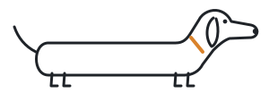

<b>English</b> · <a href="https://github.com/xingaobio/xingaobio/blob/main/README.zh-CN.md">简体中文</a>

## 👋 Hi there

<picture>
  <source media="(prefers-color-scheme: dark)" srcset="assets/dog-dark.svg">
  
</picture>

I'm Xin — I build small, careful software with AI.

I like tools that fit in your pocket: models that run on your own device, data that keeps its source attached, and interfaces where a person makes the final call. I come from experimental science, so I still measure twice before I ship.

> Small models, honest data, humans in the loop.

## 🛠 What I'm working on

| Area | What I do |
| :-- | :-- |
| 🧠 **On-device AI** | [Kobutai Model 1.0](https://github.com/xingaobio/kobutai-model): a 2 MB classifier that reads a title and knows what you're playing — it only asks a larger model when it isn't sure |
| 🎨 **Product & design** | [Kobutai 小舞台](https://github.com/xingaobio/kobutai): a browser extension that puts a tiny chibi performer next to whatever you're playing, in English, 日本語 and 中文 · [website](https://kobutai.pages.dev) |
| 🧪 **Data you can trust** | [biophys_interop](https://github.com/xingaobio/biophys_interop): turns messy scientific measurements into one schema and flags quality issues with transparent rules |
| 🤝 **Human-in-the-loop AI** | [Career CoDesk](https://github.com/xingaobio/career-codesk): a hackathon team prototype where AI drafts a support plan and an adviser approves it |
| 🧰 **Toolbox** | TypeScript · Python · Chrome extensions · FastAPI · SQLite · LLM APIs · Codex |

## 📮 Contact

Happy to chat about on-device AI, browser tools and side projects — or dachshunds.

Email: [xgaimail@proton.me](mailto:xgaimail@proton.me)

<picture>
  <source media="(prefers-color-scheme: dark)" srcset="assets/divider-dark.svg">
  
</picture>

<picture>
  <source media="(prefers-color-scheme: dark)" srcset="assets/hello-en-dark.svg">
  
</picture>

Head of QA: one dachshund. Short legs, long attention span.

